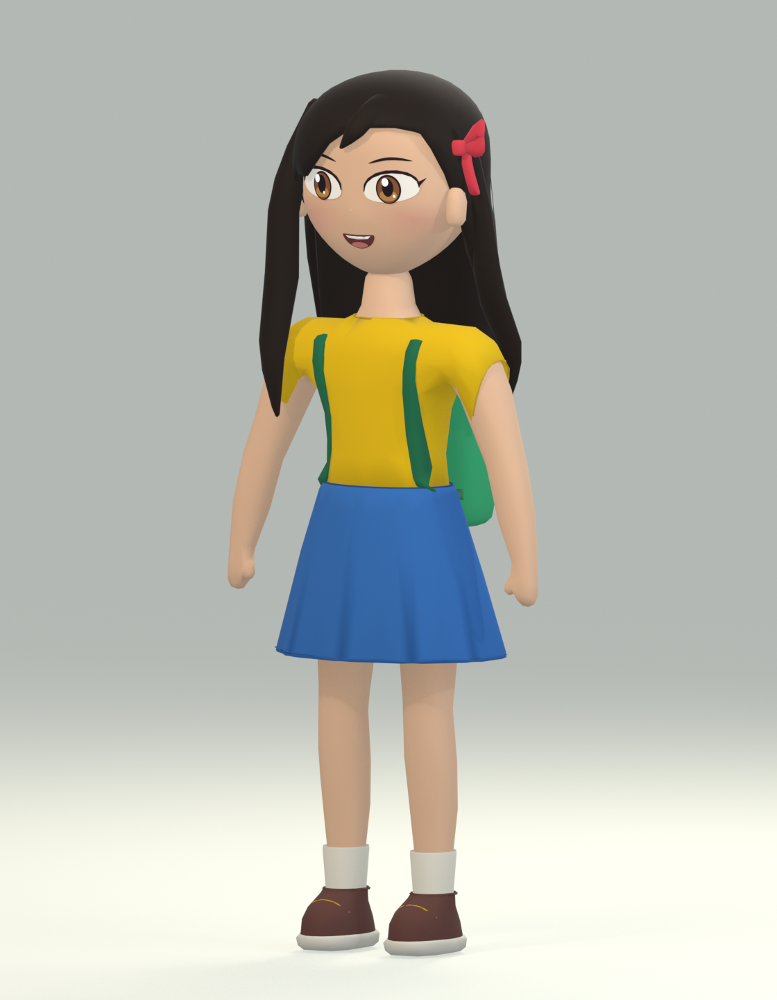

# Lily — design revision 02

Standalone, unrigged character design for visual approval. This is a new revision;
the approved files under `character-assets/lily/`, the shipped `public/assets/lily.glb`,
the procedural character, and the active game are unchanged.

The identity reference is `public/assets/lily.png`: a cheerful expression,
amber-brown eyes, long dark hair, and a yellow shirt. The blue skirt, small red
ribbon on +X, and green backpack retain the game's identifying palette. The
original design uses broad anime-inspired shapes and gentle matte shading;
it does not reproduce a character from either inspiration title.

## Review files

- [Editable Blender project](lily_redesign_v2.blend)
- [Front](renders/lily_front.png)
- [Left side](renders/lily_left.png)
- [Rear](renders/lily_rear.png)
- [Three-quarter front](renders/lily_three_quarter.png)
- [Face close-up](renders/lily_face.png)
- [Geometry and render verification](validation.json)

The full-body images are 1120 × 1440; the face is 1080 × 1080. These are actual
EEVEE renders from the saved model. Select scene `Lily_Design_02` in Blender.
The unrelated original `Scene` is preserved, and the review camera is active.
Files prefixed `preview_` are intermediate inspections, not the approval set.



## Modeling approach

- **Proportions and body:** approximately 2.086 units to the crown, with a
  moderately enlarged head, sloping shoulders, articulated limb lengths and
  small mitten hands with integrated thumbs. A connected Skin-modifier cage
  generates continuous neck, torso, arm, palm and leg surfaces. The cage and
  subdivision remain editable.
- **Face:** custom cheek, jaw and cranium profiles, with a subtly modeled nose.
  Almond eyes, tapered brows, amber irises and the small open smile are shallow
  meshes fitted to the evaluated head surface, rather than protruding spheres.
  Vertex colors provide soft cheek blush.
- **Hair:** one custom crown/back shell with an asymmetric swept hairline,
  plus three shaped locks. Surface fitting holds the crown outside the head;
  the lower hair is shaped around the shoulders and backpack. The red bow
  uses thin folded ribbon surfaces.
- **Clothes:** the shirt is a contiguous surface derived from the body with
  cut sleeve openings, neckline and finished hems. A lofted A-line skirt has
  shallow pleats, a waistband, thickness and a stitched hem. Shoes use shaped
  profiles with contrasting soles and ivory socks. The backpack has a soft
  sewn silhouette, lid, clasp, pocket and fitted shoulder straps.
- **Materials:** the main colors retain the game palette, with sRGB values
  converted to linear shader inputs. Rough, restrained Principled materials
  and warm studio lighting provide gentle shading without photorealistic
  skin textures. This is a standalone art presentation, not a new game shader.
- **Economy:** reversible Decimate modifiers reduce the evaluated design to
  **11,908 triangles**. The underlying cages and surface modifiers are kept
  for editing. Disable a component's `Economy` modifier for its higher-detail
  source surface.

## Verification and remaining work

Blender checks pass for finite geometry, the 12,000-triangle target, height,
ground clearance, zero-area faces, edges shared by more than two faces, absence
of a rig/animations, and six regression samples at the formerly intersecting
fringe. All five final renders were generated and visually inspected. Iteration
corrected exposed scalp, fringe gaps, hair/sleeve crossings, floating straps,
shirt/waist gaps, sock/shoe intersections, and facial surface fitting.

Open boundaries on facial graphics, shoe openings and some trim are intentional.
These checks do not certify every possible surface intersection or deformation.

The editable design has **67 mesh components and 24 materials**. Its triangle
count is appropriate for a future lightweight asset, but it is **not yet a
game-ready draw-call budget**: a later export should consolidate meshes and
bake or combine materials. No Chromebook frame-rate measurement has been made.

The model uses Blender **−Y forward / +Z up**. The normal glTF axis conversion
would make it **+Z forward / +Y up**, matching the game. This design prioritizes
the new proportions; it is not a drop-in match to the shipped 15-joint skeleton.
Shoulder, elbow, hip and knee loop placement, grip alignment, and front skirt
deformation need validation when a rig is authorized. Walking, sitting, phone,
flower, watering and bicycle poses remain future work. A neutral pose cannot
prove seated or pedalling clearance.

No skeleton, animation, GLB export or game integration was added. The next gate
is visual approval by the user / Claude.

## Reproduction

`scripts/build_lily.py` rebuilds **this revision's scene**, preserving other
scenes, and saves `lily_redesign_v2.blend`. It replaces manual changes inside
`Lily_Design_02`, so save a separate copy before rebuilding an edited design.
The build script is also embedded in the blend as `Lily_Design_02_build.py`.

From this directory in PowerShell:

```powershell
& 'C:/Program Files/Blender Foundation/Blender 5.2/blender.exe' --background --python scripts/build_lily.py
& 'C:/Program Files/Blender Foundation/Blender 5.2/blender.exe' --background lily_redesign_v2.blend --python scripts/render_review.py
```

`render_review.py` audits the loaded design and regenerates the five images and
`validation.json`. Construction, revisions, and the final render pass for this
delivery were performed through Blender MCP.
